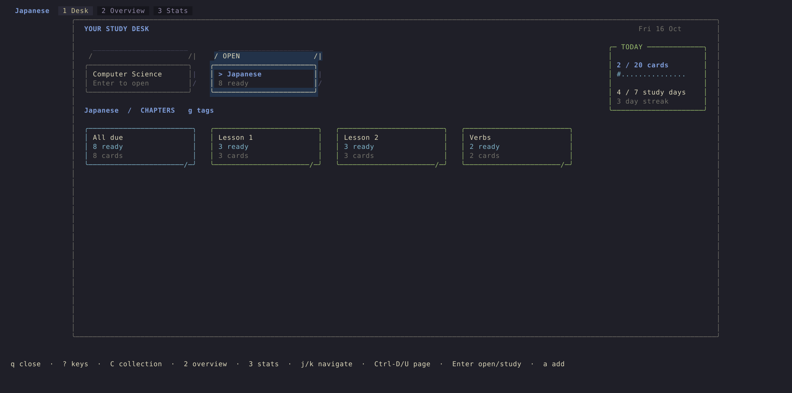

# luixbits-neorg-flashcards.nvim



Local flashcards for Neovim, stored as plain `.norg` files.

The plugin gives each subject its own collection, card types, schedule, and
review history. `:Flashcards` opens the workspace for browsing, adding,
reviewing, and checking your progress. Neorg improves normal file editing, but
it is not required to use the plugin.

## What it does

- Keeps cards and review history on your machine. There is no account, server,
  SQLite database, or Anki dependency.
- Opens a study desk with deck boxes, chapter notes, and paper card stacks.
  Overview manages collections, chapters, and cards; Stats combines a compact
  calendar with progress, ratings, and forecasts.
- Adds short card animations, session receipts, and a daily unique-card goal.
  Motion can be disabled and borders can use plain ASCII.
- Separates subjects such as Japanese and computer science so their cards,
  queues, and statistics never mix.
- Supports recognition, production, kanji, sentences, question-and-answer,
  term-and-definition, code-output, Chinese, and custom card types.
- Provides a protected composer. Labels and hints are UI decorations, not text
  you can accidentally delete.
- Edits long answers, notes, sentences, and code directly in the card form.
- Shows progressive hints and optional typed-answer differences during review.
  You still choose the rating yourself.
- Finds struggling cards in Card Clinic and explains why each card is there.
- Uses colors from the active theme by default, with exact-color overrides when
  a theme does not distinguish Again, Hard, and Good clearly.
- Keeps invalid blocks visible for repair while excluding them from review.

## Requirements

- Neovim 0.10.4 or newer
- Read and write access to the directories used for your collections

Neorg is optional. Cards still use the `.norg` suffix because that is the file
format the plugin scans. Without Neorg, the source is ordinary text; the
composer, workspace, review window, and statistics still work.

## Install

These examples pin v0.3.2. If you are updating from v0.2, follow the
[upgrade guide](docs/UPGRADING.md) to configure named collections before
opening the workspace. Existing named-collection setups need no card migration.

### lazy.nvim

With Neorg:

```lua
{
  "nvim-neorg/neorg",
  lazy = false,
  version = "*",
  config = true,
},
{
  "LuixBits/luixbits-neorg-flashcards.nvim",
  tag = "v0.3.2",
  cmd = "Flashcards",
  dependencies = { "nvim-neorg/neorg" },
  config = function()
    local presets = require("neorg_flashcards.presets")

    require("neorg_flashcards").setup({
      default_collection = "japanese",
      collections = {
        japanese = {
          label = "Japanese",
          path = vim.fn.expand("~/notes/flashcards/japanese"),
          default_file = "cards.norg",
          default_card_type = "japanese",
          schemas = presets.only("japanese"),
        },
      },
    })
  end,
}
```

If you do not use Neorg, the entry is shorter. The flashcard plugin itself
does not need LuaRocks:

```lua
{
  "LuixBits/luixbits-neorg-flashcards.nvim",
  tag = "v0.3.2",
  cmd = "Flashcards",
  config = function()
    local presets = require("neorg_flashcards.presets")

    require("neorg_flashcards").setup({
      default_collection = "japanese",
      collections = {
        japanese = {
          label = "Japanese",
          path = vim.fn.expand("~/notes/flashcards/japanese"),
          default_file = "cards.norg",
          default_card_type = "japanese",
          schemas = presets.only("japanese"),
        },
      },
    })
  end,
}
```

### Native packages and other plugin managers

Clone the release into a Neovim package directory, load it, then use the same
setup table:

```sh
plugin_root="$(nvim --headless --clean \
  '+lua io.write(vim.fn.stdpath("data") .. "/site/pack/luixbits/opt")' \
  +qa 2>/dev/null)"
mkdir -p "$plugin_root"
git clone --branch v0.3.2 --depth 1 \
  https://github.com/LuixBits/luixbits-neorg-flashcards.nvim.git \
  "$plugin_root/luixbits-neorg-flashcards.nvim"
```

```lua
vim.cmd.packadd("luixbits-neorg-flashcards.nvim")
-- Call require("neorg_flashcards").setup(...) here.
```

For a local checkout, replace the repository name in the lazy.nvim example
with `dir = "~/projects/luixbits-neorg-flashcards.nvim"`.

## First run

1. Run `:Flashcards`.
2. Press `a` to add a card. With the setup above, the composer opens directly.
3. Fill the required fields and press `Ctrl-S`.
4. Open the deck box with `Enter`, then choose All due or a chapter note.
   Press `Enter` again to start its due stack. `d` starts all due cards directly.
5. Reveal with `Space` or `Enter`, then rate with `1`, `2`, or `3`.

The workspace shows useful current shortcuts in its winbar by default. Press
`?` for the complete list for the page or review state you are in. That help
window is searchable with Neovim's normal `/`, `n`, and `N` keys. Set
`ui.show_shortcuts = false` if you prefer less persistent chrome.

App scratch windows suppress visible whitespace and concealment; normal note
buffers retain their settings.

The plugin does not install global mappings. If you want one, map only the
workspace entry point:

```lua
vim.keymap.set("n", "<leader>nc", "<cmd>Flashcards<CR>", {
  desc = "Open flashcards",
})
```

`a` asks for a card type only when the active collection explicitly enables
several. In that case, the “What do you want to practice?” picker shows the
enabled types. It never asks which collection to use; the page heading shows
the active one.

## Add another collection

A collection owns one directory, one review-history file, its card types, and
its scheduling settings. Collection directories cannot overlap, and two
collections cannot share a history file. Add another entry to `collections`
when you want to keep a subject separate:

```lua
local presets = require("neorg_flashcards.presets")

require("neorg_flashcards").setup({
  default_collection = "japanese",
  collections = {
    japanese = {
      label = "Japanese",
      path = vim.fn.expand("~/notes/flashcards/japanese"),
      default_file = "cards.norg",
      default_card_type = "japanese",
      schemas = presets.only("japanese"),
    },
    computer_science = {
      label = "Computer Science",
      path = vim.fn.expand("~/notes/flashcards/computer-science"),
      default_file = "cards.norg",
      default_card_type = "question_answer",
      schemas = presets.only("question_answer"),
    },
  },
})
```

Setup creates either directory when it is missing. Restart Neovim, then press
`C` anywhere in the workspace to switch between the configured collections, or
run `:Flashcards collection computer_science`. To create a deck in the UI,
open Overview with `2`, select a collection, press `m`, and choose New collection.
Switching is blocked while a composer or review
session is open so a draft or rating cannot drift into another subject.

Each collection above enables one card type, so `a` opens its composer directly.
Add more types only when you want the extra choice described below.

Use as many `.norg` files as you like inside a collection:

```text
flashcards/japanese/
├── inbox.norg
├── marugoto-a1/
│   ├── topic-01.norg
│   └── topic-02.norg
└── grammar.norg
```

Open a chapter normally, then use `:Flashcards add` to add there or
`:Flashcards review file` to study only that file. From another buffer, add
uses the collection's `default_file`. The plugin refuses to write outside the
active collection.

## One command

`:Flashcards` is the only Ex command. Completion exposes its routes and the
configured collection and card-type IDs.

| Command | Action |
| --- | --- |
| `:Flashcards` / `:Flashcards desk` | Open the study desk |
| `:Flashcards overview` | Open the manager |
| `:Flashcards cards` | Compatibility alias for Overview |
| `:Flashcards stats` | Open Stats |
| `:Flashcards collection [id]` | Choose or directly switch collection |
| `:Flashcards add [type]` | Choose or directly add a card type |
| `:Flashcards review due` | Review active new and due cards |
| `:Flashcards review all` | Cram every active valid card |
| `:Flashcards review file` | Review the current collection file |
| `:Flashcards review tag [tag]` | Review an exact tag; prompt when omitted |
| `:Flashcards review score [again\|hard\|good\|new]` | Review a rating bucket |
| `:Flashcards open` | Create or open the active collection's default file |
| `:Flashcards check` | Check cards, IDs, scheduling data, and history |
| `:Flashcards help` | Open the concise in-editor guide |

## Workspace

The workspace uses buffer-local mappings. Nothing remains mapped after it
closes.

- `1`, `2`, `3`: open Desk, Overview, or Stats.
- `Tab`, `Shift-Tab`: move between pages.
- `C`: switch collection.
- `?`: show the current page's complete key list.
- `H`: open the short plugin guide.
- `Ctrl-h/j/k/l` or `Ctrl-W h/j/k/l`: focus the pane in that direction.
  `Ctrl-W w` cycles panes. In narrow windows, use `Ctrl-j/k` for the stacked panes.
- `h/j/k/l` or arrows: move through the Desk and calendar; in Overview,
  `j/k` selects rows, `l`/Right opens a selection, and `h`/Left goes back.
  `j/k` or Up/Down scrolls the focused detail pane.
- `Ctrl-D`, `Ctrl-U`, PageDown, PageUp: move half a page.
- `gg`, `G`: go to the top or bottom.
- `d`, `A`: review due cards or all active cards.
- `a`: add a card in its chapter; on Overview’s collection list, create a collection.
- `c`: run the collection check; `R`: reload; `q`: close.

Desk shows one box per collection, with chapter notes inside it. `Enter` opens
a box, then studies the selected note's due cards. `g` switches between chapters
and tags. Move by rows with `j/k` and by items with `h/l`; `/` finds notes. `C`
reaches every collection when the shelf has more boxes than fit. All due
contains each card once. Caught-up notes do not start a cram session.

Overview opens a compact collection → chapter → card browser. `Enter`, `l` or
Right opens a collection or chapter; `h` or Left goes back. The side pane shows
the selected item's details and actions. `:Flashcards cards` goes straight to
the card list.

| Selection | Create | Rename/edit | Remove | Other |
| --- | --- | --- | --- | --- |
| Collection | `a` new collection | `e` display label | `D` detach UI-created collection | `m` settings |
| Chapter | `n` new chapter; `a` card here | `e` name | `D` move its cards to Unfiled | `r` study due cards |
| Card | `a` card in this chapter | `e` composer | `D` confirmed source deletion | `M` move to chapter; `p` preview |

- `/` searches fronts, answers, tags, types, sources, dates, and states.
- `f` selects a state, Card Clinic, or card type; `g` filters by tag.
- `o` cycles due, front, state, and source sorting.
- `X` clears search/filter; `Esc` clears an active filter, goes back a level,
  or closes the collection list.
- `Enter` or `r` reviews a selected active, valid card.
- `x` suspends/resumes a card; `b` buries/unburies it.
- `m` opens actions for the selected collection, chapter, or card.

Menus, confirmations, and small inputs open in a bordered box using the desk's
colors and `ui.ascii` setting. Use `j/k`, Ctrl-j/k, or arrows to select, Enter
or `l` to choose, `h` to go back in a submenu, and `q` or Esc to cancel.
Long lists support Ctrl-D/U and gg/G. Inputs open ready to type; Enter confirms,
Esc returns to Normal mode, and `q` cancels there. Invalid values stay in the
input with an explanation. Deletion starts on Cancel and describes what gets
removed or kept. There is no extra picker setup.

Invalid cards appear as `[INVALID]`. They remain searchable and editable, but
cannot be reviewed or scheduled. A closed invalid block can also be deleted;
an unclosed block needs its missing `@end` first. Deleting an unloaded card
first saves the previous complete source as
`<source>.flashcards-backup`. Deleting from an open modified buffer leaves the
change unsaved so normal buffer undo still works. Deleting a card does not
remove its review-history entries.

Stats opens a Monday-first month calendar. Use `h/l` for days, `j/k` for weeks,
`[` and `]` for months, and `.` for today. `Enter` opens that day's cards in
Overview. The detail pane shows unique cards, answers, ratings, recorded answer
time, hints, and saved goals. Historical cards that no longer exist are marked
as unavailable. Future dates show a schedule snapshot that later ratings can
change; overdue cards stay in today's backlog.

The main area shows totals, streaks, retention, card states, median answer
time, heatmap, seven-day forecast, and Needs attention beside the compact
calendar. `Ctrl-D` / `Ctrl-U` scroll down/up, and `G` / `gg` go to the
bottom/top. These keys leave the selected date unchanged. Use `Ctrl-h/l` to
switch between analytics and day details, or `Ctrl-j/k` when they are stacked.
`Ctrl-W w` also switches panes; scrolling affects the focused pane.
Weekly card-days count a card once per day; they are not a
count of distinct cards across the week. Retention means Hard or Good as a
percentage of effective ratings. Recorded answer time includes time with a
card open, and missing durations remain unavailable.

### Collections, chapters, tags, and goals

A collection is a subject such as Japanese or Computer Science. Chapters such
as Lesson 1, Lesson 2, or Verbs organize cards inside it. A card belongs to at
most one chapter and can have several tags, such as `travel` or `household`.
Neither chapter names nor tags depend on source filenames.

Existing cards start in Unfiled. Create a chapter with `n`, then use `M` on a
card to move it. Select a collection, then use `m` → Tags → a tag → Create
chapter from tag to move matching cards into a new chapter after confirmation. Tags
stay on the cards. Removing a chapter returns its cards to Unfiled and keeps
their IDs, scheduling, and history. Adding from a chapter assigns the new card
to it; the card still goes into the collection's configured default file.

The collection menu has Rename collection, New chapter, Tags, and Daily goal.
For UI-created collections, the goal and card types are under Study settings.
The chapter menu has Add card, New chapter, Rename chapter, and Remove chapter.
The card menu has Edit card, Move card to chapter, and Delete card. Invalid
cards offer source repair; unclosed blocks cannot be deleted.

Under Tags, choose a tag to rename, merge, or remove it without deleting cards.
Note appearance holds its display label, theme color, and shelf order.
Rename and merge operate on complete tag tokens:
changing `food` leaves `seafood` alone. The operation confirms its card count,
preflights sources, and saves `<source>.flashcards-tags-backup` snapshots.
Modified source buffers stay unsaved until you write them. A partial failure
reports the changed files and the point where it stopped.

New collection asks for an ID, name, directory, and bundled card type. The same
root, schema, and history-isolation checks used by setup apply. Study settings
can enable another card type or change the default for UI-created collections.
Configured collections keep those settings in Lua or Nix. Detach collection is
available for UI-created collections and preserves their files. Setting
`deck_registry = false` hides New collection from the menu.

The default goal is 20 unique cards per day; set it to 0 to disable it. Again
counts as study, and retries on the same day count once. Undo reverses progress.
The day's goal is saved when study begins, so editing the default does not
change historical stamps. A goal does not limit queues or change scheduling.
Cards awaiting durable history delivery count provisionally and are deduplicated
on replay. Reviews in unsaved source buffers enter daily history when saved.

Chapter names and membership, presentation, and goal snapshots live in each root's
`.flashcards-workspace.json`. UI-created deck definitions live in
`stdpath("data")/neorg-flashcards/decks.json`; set `deck_registry` to another
path, or `false` for a wholly declarative setup. Include these files in your
normal backups. Invalid sidecars are reported and preserved for repair.

## Card Clinic

Press `f` in Overview and choose Needs attention (Card Clinic). A card appears
when it is active and any of these are true:

- its lapse count reached `leech_threshold`;
- at least two of its last three effective reviews were Again;
- its latest rating was Again;
- at least two of its last three reviews used hints.

Undo events are respected. Suspended and buried cards stay out of the clinic.
The detail pane states the non-redundant evidence and shows a compact recall
trail, with the newest rating on the right. Stats uses the same rules, so its
“Needs attention” count and the Overview filter cannot disagree.

## Composer

The composer gives each field a label above its input, with room between
fields on larger screens. Labels identify the front and answer fields and
spell out which values are required or optional. The header shows the
collection, chapter, card type, and destination file. Colors follow your theme.

Labels, placeholders, and errors stay outside the editable values. Backspace
and Delete cannot join adjacent fields. The form opts out of completion through
the buffer-local `completion` flag, which Blink supports, and reapplies its
navigation and deletion guards when entering the draft.

- `Tab` and `Shift-Tab` move between fields in Normal or Insert mode.
- Insert mode: `Enter` advances and saves on the final field.
- Normal mode: `j/k` or arrows move through the editable lines; `Enter` or `i`
  edits at the cursor.
- `Ctrl-S`: save and return.
- `Ctrl-N`: save and start another card.
- `q` or `Esc` in Normal mode: cancel, with confirmation for a changed draft.
- `?`: show every form shortcut.

Every field is editable directly in the form, including Notes. Tab and Enter
keep you in Insert mode as you move between fields. For longer notes, answers,
or code, paste multiple lines or use native `o`/`O` in Normal mode to add a
line. Paragraphs wrap to fit the window; line breaks and indentation are
preserved when saving. `Ctrl-S` saves the whole card in one step.

See the [composer screenshots](docs/demo/README.md#card-entry-refinement).

## Card types

Bundled types:

| ID | Direction | Intended use |
| --- | --- | --- |
| `japanese` | Japanese word → reading + English | Recognize a word or expression |
| `japanese_production` | English → Japanese word | Produce the Japanese word or expression |
| `japanese_kanji` | Kanji → reading + meaning | Study one kanji, with an optional example |
| `japanese_sentence` | Japanese sentence → English | Understand a sentence in context |
| `chinese` | Chinese | Pinyin and English recognition |
| `question_answer` | Question | General study prompts with long answers |
| `term_definition` | Term | Definitions and examples |
| `code_output` | Code | Predict output and explain it; code is never executed |

The default example enables only Japanese word → reading + English. The other
three Japanese directions are optional: reverse the prompt to produce a word,
study one kanji, or translate a sentence. Add their IDs to `presets.only(...)`
when you want those choices. If a collection has one configured type, `a` opens
it directly. If you explicitly configure several, `a` opens the “What do you
want to practice?” picker with the default type first. An explicit
`:Flashcards add term_definition` skips that picker.

`presets.only(...)` raises on an unknown name, so a typo cannot quietly remove
a card type.

A custom type is a schema:

```lua
local spanish = {
  label = "Spanish production",
  front = "english",
  fields = {
    {
      key = "english",
      title = "English",
      required = true,
      placeholder = "e.g. cat",
    },
    {
      key = "spanish",
      title = "Spanish",
      required = true,
      reveal = true,
      typed_answer = true,
      placeholder = "e.g. gato",
    },
    {
      key = "notes",
      title = "Notes",
      reveal = true,
      multiline = true,
    },
    { key = "tags", title = "Tags" },
  },
}
```

Each schema needs a `front` field and at least one field. Set `required` for
validation, `reveal` for answer-side content, `multiline` to allow line breaks,
and `typed_answer` for text accepted by the review comparison. A typed
answer field must also be a reveal field.

## Stored card format

The plugin creates stable IDs and scheduling metadata. A Japanese card looks
like this:

```norg
@flashcard japanese
id: fc_0123456789abcdef01234567
japanese: 勉強
reading: べんきょう
english: study
notes: |
  Common noun and する verb.
  Often used in 勉強します.
tags: jlpt-n5 study
score: 2
reviewed: 2026-08-22
due: 2026-08-22 18:00
interval: 0.25
ease: 2.5
reps: 4
lapses: 1
lifecycle: learning
availability: active
@end
```

Long values use an explicit `field: |` block. Every content line begins two
spaces beyond its card directive; further indentation belongs to the value.
An empty value line contains those two storage spaces. The closing `@end`
aligns with `@flashcard`, including when a card sits below an indented Neorg
node.

```norg
@flashcard code_output
id: fc_abcdef0123456789abcdef01
code: |
  local values = { 1, 2, 3 }
  print(#values)
output: |
  3
explanation: |
  The length operator counts the sequence entries.
tags: lua tables
@end
```

Single-line cards remain valid. There is no implicit continuation syntax; a
free-standing line inside a card is reported as invalid instead of being
silently attached to the preceding field.

## Review

Review mappings exist only in the review window:

- `l`, Right, `Space` or `Enter`: reveal.
- `h`, Left, `q` or `Esc`: return to the workspace.
- `H`: show a progressively larger hint.
- `t`: type and compare an answer when the card type enables it.
- `1`: Again; requeue once later in this session.
- `2`: Hard; remove from the current queue.
- `3`: Good; remove from the current queue.
- `j/k` or Down/Up: browse pending cards.
- `u`: undo the latest rating while it is still the latest action.
- `b`: bury until tomorrow; `x`: suspend; `e`: edit.
- `?`: current review keys.

Rating keys do nothing until you explicitly reveal the answer. This prevents
a held key from revealing and rating the next card. The piles distinguish
pending attempts from cards reviewed in this session. A finished receipt shows
unique cards and answer counts separately; `u` undoes the last rating, `Enter`
returns to the desk, and `s` opens Stats.

The source filename appears in muted workspace chrome, outside the study card.
The revealed card shows the next interval beside each rating. An Again card is
requeued only once per session, so Again cannot create an endless retry loop.

Bury (`b`) sets a card aside until the next local midnight. It becomes eligible
again automatically, subject to its existing due date. Suspend (`x`) excludes
the card until you resume it with `x` in Overview. You can unbury a card early
with `b` there too. Both actions remove it from the current review and preserve
its content, learning schedule and history. They do not count as ratings.

Typed answers are intended for short answers and are opt-in per field.
Comparison ignores case, outside spaces, and repeated whitespace, then chooses
the closest configured answer. A near miss shows aligned “Yours” and “Answer”
lines; a middle dot marks missing text, so the difference remains readable
without color. The comparison never rates the card. Typed text and diff details
stay in memory for that attempt and are not written to the source or review
history. The built-in prompt entry is also removed from Neovim's input history.
A custom `vim.ui.input` implementation is responsible for any history of its
own.

Cloze markers work in any field:

```text
東京は{{c1::日本}}の首都です
Tokyo is the capital of {{c1::Japan|country}}
```

Before reveal they appear as `[...]` or `[country]`; afterward the plain answer
is shown.

## Scheduling

The built-in scheduler uses three ratings:

| Rating | First interval | Later interval | Ease change |
| --- | ---: | ---: | ---: |
| `1` Again | 10 minutes | 10 minutes | `-0.20`, minimum `1.30` |
| `2` Hard | 6 hours | previous interval × `1.20` | unchanged |
| `3` Good | 3 days | previous interval × current ease | `+0.05`, maximum `2.80` |

Hard and Good intervals are capped at 365 days by default. Multiplication
lets a remembered card move farther into the future, while the cap prevents
unbounded growth. Rating it Again resets the delay to ten minutes and lowers
its ease.

Each collection can override:

```lua
scheduling = {
  again_minutes = 10,
  hard_hours = 6,
  good_days = 3,
  starting_ease = 2.5,
  min_ease = 1.3,
  max_ease = 2.8,
  max_interval_days = 365,
}
```

The UI separates three ideas:

| Axis | Values |
| --- | --- |
| Lifecycle | `new`, `learning`, `review`, `relearning` |
| Timing | `due`, `overdue`, `scheduled` |
| Availability | `active`, `suspended`, `buried` |

Buried cards return at midnight the next day. Suspended cards remain out of
normal queues until resumed. `review all` is an explicit cram mode and ignores
due time, but still excludes buried and suspended cards.

## Configuration

Top-level options:

| Option | Meaning |
| --- | --- |
| `default_collection` | ID selected at startup; required |
| `collections` | Non-empty map of collection IDs to collection tables |
| `deck_registry` | Path for UI-created deck definitions, or `false` to disable them |
| `ui.show_shortcuts` | Show compact shortcut ribbons; default `true` |
| `ui.motion` | Short, cancellable card animations; default `true` |
| `ui.ascii` | Plain ASCII desk/card borders; default `false` |
| `ui.desk_highlights` | Theme links or exact attributes for desk materials and selection |
| `ui.rating_highlights` | Again, Hard, and Good highlight definitions |
| `ui.heatmap_highlights` | Activity highlight definitions for levels 0–4 |
| `on_review(event)` | Optional observer after a source change persists |

Collection options:

| Option | Meaning |
| --- | --- |
| `label` | Human name shown in the UI; defaults to the ID |
| `path` | Root scanned recursively and used as the write boundary; required |
| `default_file` | `.norg` path inside `path`; relative paths resolve from it; default `cards.norg` |
| `default_card_type` | Configured schema used as the first/default choice; required |
| `schemas` | Non-empty map of card types |
| `history_file` | `.jsonl` path inside `path`; default `reviews.jsonl` |
| `scheduling` | Per-collection scheduler overrides |
| `leech_threshold` | Lapses needed for a leech warning; default `8` |

Collection IDs and schema IDs begin with a lowercase letter and use lowercase
letters, numbers, `_`, or `-`. Setup rejects unknown options, overlapping
collection roots, shared or hard-linked ledgers, paths outside a collection,
and invalid schemas. Missing collection directories are created during setup
and pinned to their resolved identity for the session. If a root is moved,
replaced, or retargeted through a symlink, operations stop until setup runs
again.

### Theme colors

The defaults follow the colorscheme:

```lua
ui = {
  motion = true,
  ascii = false,
  desk_highlights = {
    ink = { link = "Normal" },
    edge = { link = "Comment" },
    shadow = { link = "NonText" },
    note = { link = "String" },
    title = { link = "Title" },
    selected = { link = "IncSearch" },
    accent = { link = "Special" },
    muted = { link = "Comment" },
  },
  rating_highlights = {
    again = { link = "DiagnosticError" },
    hard = { link = "DiagnosticWarn" },
    good = { link = "DiagnosticOk" },
  },
  heatmap_highlights = {
    [0] = { link = "NonText" },
    [1] = { link = "Comment" },
    [2] = { link = "DiagnosticHint" },
    [3] = { link = "DiagnosticInfo" },
    [4] = { link = "DiagnosticOk" },
  },
}
```

If those theme groups are too similar, supply exact attributes:

```lua
ui = {
  rating_highlights = {
    again = { fg = "#ff5f5f", bold = true },
    hard = { fg = "#e5c07b" },
    good = { fg = "#98c379" },
  },
}
```

Overrides are restored after a colorscheme change. The UI also uses labels,
glyphs, and text, so state is not communicated by color alone.

### Review observer

`on_review(event)` receives a copy after a source change persists. Events have
`type`, `event`, `collection_id`, `card_type`, `card_id`, `path`, and a
timestamp. Rated events also include rating, duration, hint, scheduling, and
session data. The observer cannot cancel a completed change, and its errors do
not stop review.

## Data and recovery

Normal review and card-state events are appended to `reviews.jsonl` inside the
active collection. Undo writes a compensating event instead of rewriting the
ledger.

If a card source is open with unsaved changes, ratings update that buffer and
wait to append history until you save it. Undo before saving removes the
pending event. If an append fails after the source is durable, the plugin
keeps the event under Neovim's state directory and retries it on later writes,
focus, setup, and exit.

`:Flashcards check` and `:checkhealth neorg_flashcards` report parser errors,
invalid schemas, missing or duplicate IDs, malformed scheduling data, leeches,
and history problems. Every copy of a duplicate ID is quarantined because the
plugin cannot safely decide which block owns that review history.

## NVF / Nix

Add the flake input:

```nix
inputs.luixbits-neorg-flashcards.url =
  "github:LuixBits/luixbits-neorg-flashcards.nvim/v0.3.2";
```

Import `homeManagerModules.nvf` (or `nixosModules.nvf`) and configure it:

```nix
{
  imports = [
    inputs.luixbits-neorg-flashcards.homeManagerModules.nvf
  ];

  programs.nvf.neorg-flashcards = {
    enable = true;

    schemaPresets = {
      japanese = [ "japanese" ];
      computer_science = [ "question_answer" ];
    };

    setupOpts = {
      default_collection = "japanese";
      collections = {
        japanese = {
          label = "Japanese";
          path = "~/notes/flashcards/japanese";
          default_file = "cards.norg";
          default_card_type = "japanese";
        };
        computer_science = {
          label = "Computer Science";
          path = "~/notes/flashcards/computer-science";
          default_file = "cards.norg";
          default_card_type = "question_answer";
        };
      };
      ui.show_shortcuts = true;
    };

    keymaps = {
      enable = true;
      prefix = "<leader>nc";
    };
  };
}
```

To add a collection with NVF, add its ID in two places: once under
`setupOpts.collections` for its path and defaults, and once under
`schemaPresets` for its bundled card types. The `computer_science` entries above
are the complete second-collection recipe. `C` can switch to it after the new
configuration loads; it does not create it.

`schemaPresets` is keyed by collection ID and merges bundled schemas into that
collection. The module creates exactly one optional global mapping: the exact
`keymaps.prefix` opens `:Flashcards`. It does not install or configure Neorg.

After changing the input, run:

```sh
nix flake update luixbits-neorg-flashcards
```

## Lua API

Commands are thin wrappers around public functions:

```lua
local flashcards = require("neorg_flashcards")

flashcards.overview()
flashcards.select_collection("computer_science")
flashcards.add_kind("term_definition")
```

Useful entry points:

| Function | Result |
| --- | --- |
| `setup(opts)` | Configure the plugin; raises on invalid options |
| `active_collection()` | Defensive copy of the active collection |
| `select_collection(id)` / `choose_collection()` | Switch directly or open the picker |
| `overview(opts?)`, `cards()`, `stats()` | Open the workspace |
| `add_kind(type?)`, `add_to_default(type?)` | Open the composer |
| `review_due()`, `review_all()`, `review_file()` | Start a review |
| `review_tag(tag?)`, `review_score(score?)` | Start a filtered review |
| `rate_current(1\|2\|3)` | Rate and return `ok, message, persisted` |
| `undo_last_rating()`, `bury_current()`, `suspend_current()` | Mutate the current review card |
| `validate_collection()` | Return status, cards, health issues, diagnostics |
| `command(args?)` | Dispatch the same route as `:Flashcards` |

UI-opening and control functions return whether the synchronous request was
accepted. A picker or input dialog can return `true` before its callback receives
a choice. Inspection calls such as `active_collection()` and
`get_review_state()` return data, while validation calls return their documented
status and diagnostics. Source mutations return `ok, message, persisted`;
`persisted = false` means an open modified source buffer still needs to be
written.

See `:help neorg-flashcards-lua-api` for the complete function list.

## Upgrade

Version 0.3 intentionally replaces the v0.2 single-collection setup. There
are no compatibility aliases. Read [docs/UPGRADING.md](docs/UPGRADING.md)
before updating a working configuration.

## Development

See [CONTRIBUTING.md](CONTRIBUTING.md) for the local workflow and
[SECURITY.md](SECURITY.md) for private reports.

```sh
bash scripts/test.sh
bash scripts/check-clean-install.sh
nix flake check --print-build-logs
```

The test suite covers the minimum supported Neovim version, plain Neovim,
Neorg integration, source/history failure recovery, and the NVF module.

## Platform support

Linux and macOS are supported. Windows path behavior remains best effort until
it has a regular maintainer or CI runner.

## Module layout

```text
lua/neorg_flashcards/init.lua          public setup, command routing, mutations
lua/neorg_flashcards/collections.lua   workspace validation and active collection
lua/neorg_flashcards/presets.lua       bundled card types
lua/neorg_flashcards/schema.lua        schema and card validation
lua/neorg_flashcards/parser.lua        block parsing and collection discovery
lua/neorg_flashcards/form.lua          protected add/edit composer
lua/neorg_flashcards/review.lua        finite review queue and answer rendering
lua/neorg_flashcards/answer_diff.lua   UTF-8-aware typed-answer comparison
lua/neorg_flashcards/card_insights.lua recall trails and clinic signals
lua/neorg_flashcards/overview.lua      Desk, Overview, Clinic, and Stats workspace
lua/neorg_flashcards/schedule.lua      scheduling and card-state calculation
lua/neorg_flashcards/store.lua         guarded source writes and deletion
lua/neorg_flashcards/history.lua       append-only JSONL ledger and retry outbox
lua/neorg_flashcards/stats.lua         retention, heatmap, and forecast sections
lua/neorg_flashcards/health.lua        collection inspection and health provider
lua/neorg_flashcards/ui/actions.lua    mappings, shortcut ribbons, contextual help
```

## License

MIT. See [LICENSE](LICENSE).
